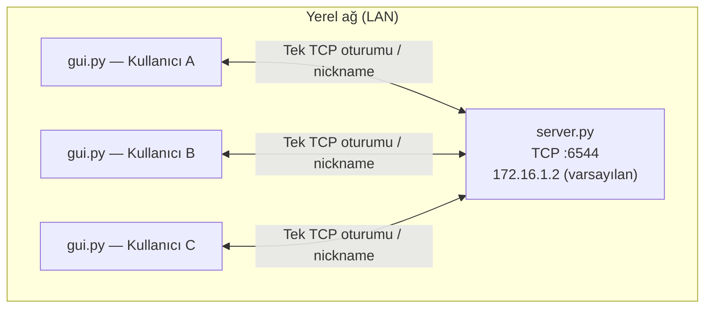
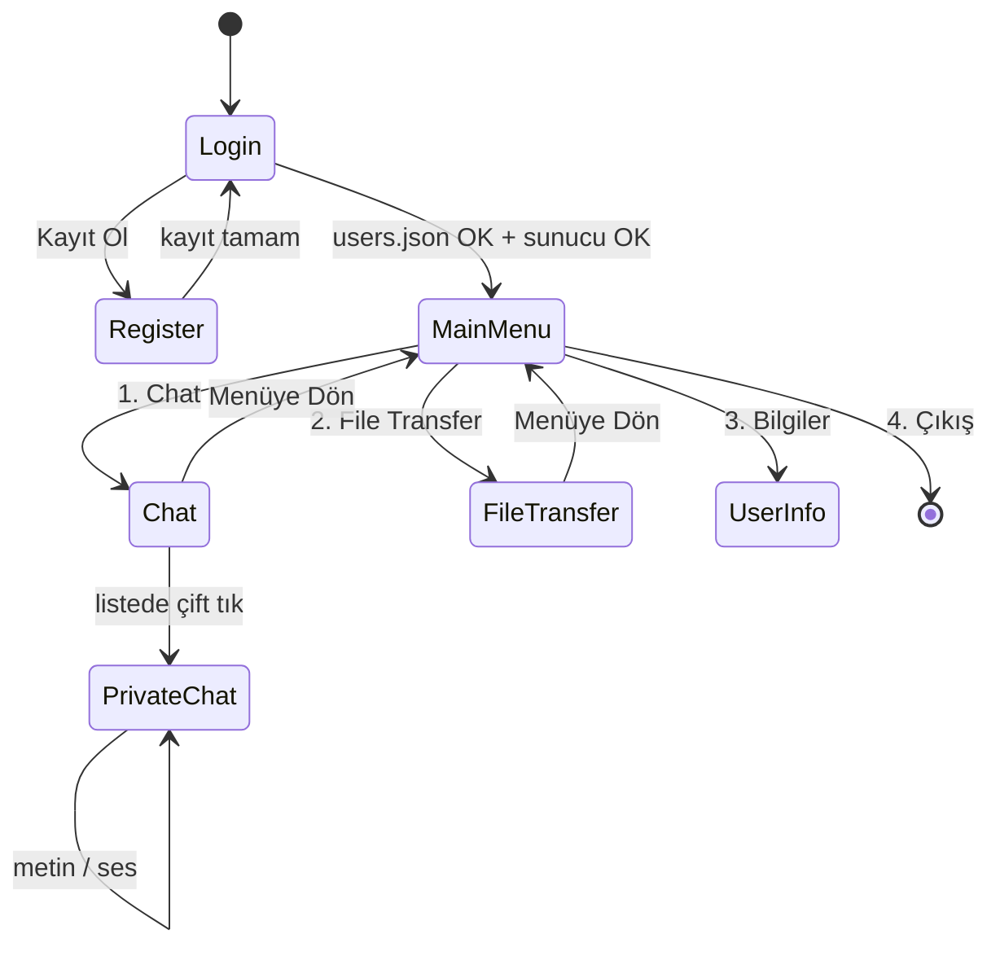
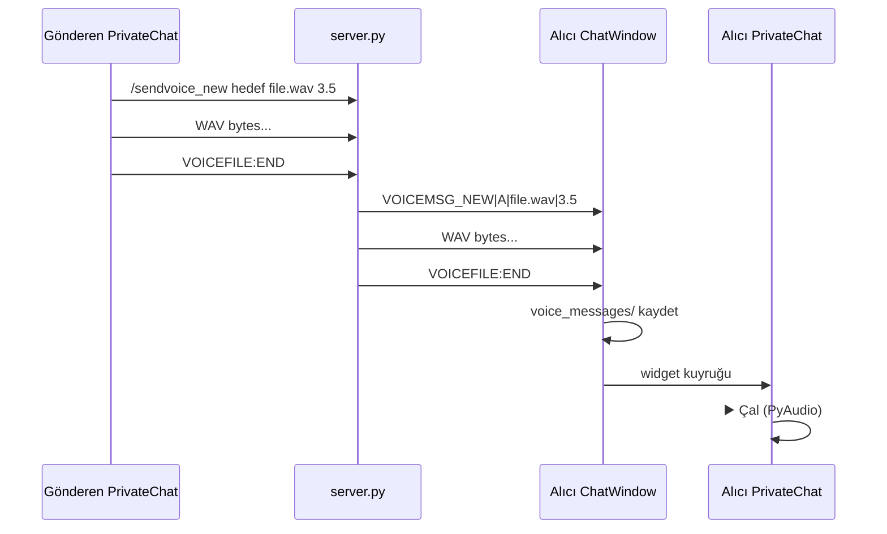

# netChat

**netChat**, yerel ağ (LAN) ortamında çalışmak üzere tasarlanmış, merkezi TCP sunuculu bir anlık mesajlaşma uygulamasıdır. İstemciler **Python + Tkinter** masaüstü arayüzü kullanır; sunucu saf **Python `socket`** ile yazılmıştır. Metin sohbeti, özel mesaj, dosya aktarımı ve özel sohbette sesli mesaj (WAV) desteklenir.

Bu belge, kaynak koda bakmadan sistemin mimarisini, ağ topolojisini, özelliklerini, veri modellerini, protokolü ve bilinen sınırları anlamanız için yazılmıştır.

---

## İçindekiler

1. [Sistem topolojisi](#1-sistem-topolojisi)
2. [Mimari özet](#2-mimari-özet)
3. [Teknoloji yığını ve kullanım yerleri](#3-teknoloji-yığını-ve-kullanım-yerleri)
4. [Bileşenler ve sorumluluklar](#4-bileşenler-ve-sorumluluklar)
5. [Özellikler (detaylı)](#5-özellikler-detaylı)
6. [İstemci arayüz akışı](#6-istemci-arayüz-akışı)
7. [Sunucu yaşam döngüsü](#7-sunucu-yaşam-döngüsü)
8. [İletişim protokolü](#8-iletişim-protokolü)
9. [Veri modelleri ve dosya sistemi](#9-veri-modelleri-ve-dosya-sistemi)
10. [Eşzamanlılık ve thread modeli](#10-eşzamanlılık-ve-thread-modeli)
11. [Yapılandırma sabitleri](#11-yapılandırma-sabitleri)
12. [Kurulum ve çalıştırma](#12-kurulum-ve-çalıştırma)
13. [Operasyonel senaryolar](#13-operasyonel-senaryolar)
14. [Bilinen sınırlar ve tutarsızlıklar](#14-bilinen-sınırlar-ve-tutarsızlıklar)
15. [Güvenlik](#15-güvenlik)

---

## 1. Sistem topolojisi

### 1.1 Mantıksal diyagram

Tüm istemciler **tek bir merkezi sunucuya** TCP ile bağlanır. Sunucu mesajları **relay (aktarım)** eder; istemciler arasında doğrudan (P2P) soket yoktur. Dosya ve ses verisi de sunucu üzerinden hedef sokete iletilir.



### 1.2 Fiziksel dağılım

| Konum | Ne çalışır | Kalıcı veri |
|--------|------------|-------------|
| **Sunucu makinesi** | Yalnızca `server.py` | Yok (bellekte bağlı kullanıcı listesi) |
| **Her istemci makinesi** | `gui.py` + yardımcı modüller | `users.json`, `chat_logs/`, `voice_messages/` |

Sunucu kullanıcı hesabı veya sohbet geçmişi **tutulmaz**. Kayıt/giriş ve mesaj geçmişi **tamamen istemci tarafında** dosyalara yazılır; farklı bilgisayarlardaki `users.json` ve `chat_logs` otomatik senkronize olmaz.

### 1.3 Bağlantı kuralları

- Protokol: **TCP/IPv4** (`AF_INET`, `SOCK_STREAM`).
- Her **nickname** için sunucuda **en fazla bir** aktif soket vardır (`chat_core.clients` sözlüğü).
- İstemci aynı anda **Chat** ve **File Transfer** modunda **iki ayrı bağlantı** açamaz (ikinci giriş “nickname alınmış” hatasına yol açar). Ana menüden ya sohbet ya dosya modu seçilir; biri kapatılmadan diğeri açılmaz.
- Giriş ekranında sunucuya **test bağlantısı** yapılır; kısa süreli bir oturum açılıp kapatılabilir (aşağıda [Giriş](#51-kayıt-ve-giriş) bölümüne bakın).

---

## 2. Mimari özet

### 2.1 Katmanlar

```
┌─────────────────────────────────────────────────────────┐
│  Sunum (Tkinter): LoginWindow, MainMenu, ChatWindow,    │
│  PrivateChatWindow, FileTransferWindow                  │
├─────────────────────────────────────────────────────────┤
│  Uygulama: mesaj kuyruğu, sohbet geçmişi, ses kaydı     │
│  (chat_logger, voice_storage, voice_chat)               │
├─────────────────────────────────────────────────────────┤
│  Ağ: socket connect/send/recv, protokol ayrıştırma      │
├─────────────────────────────────────────────────────────┤
│  Sunucu: chat_core (oturum), handle_client, ping        │
└─────────────────────────────────────────────────────────┘
```

### 2.2 Tasarım kararları

- **Merkezi sunucu + düz metin/ikili protokol**: HTTP/WebSocket yok; satır sonu (`\n`) ile ayrılmış komutlar ve ham byte aktarımı.
- **Sunucu durumsuz (stateless persistence)**: Oturum bilgisi sadece RAM’de; yeniden başlatmada tüm bağlantılar kopar.
- **Tkinter thread güvenliği**: Ağ thread’leri UI’ya doğrudan yazmaz; `queue.Queue` + `root.after(100ms)` ile ana thread’de güncelleme.
- **Özel sohbet geçmişi yerel**: Gizlilik veya sunucu yükü değil; istemci tasarım tercihi — log dosyaları gönderen/alıcı makinede oluşur.

---

## 3. Teknoloji yığını ve kullanım yerleri

| Teknoloji | Nerede | Nasıl kullanılıyor |
|-----------|--------|---------------------|
| **Python 3** | Tüm proje | Tek çalışma ortamı; paket yöneticisi/requirements dosyası yok |
| **`socket`** | `server.py`, `gui.py` | TCP sunucu/istemci, `TCP_NODELAY`, `recv(8192)` / `send` |
| **`threading`** | `server.py`, `gui.py`, `voice_chat.py` | İstemci başına sunucu thread’i; ping döngüsü; mesaj alma; ses kaydı |
| **`threading.Lock`** | `chat_core.py`, `ChatWindow` | `clients` sözlüğü ve kullanıcı listesi güncellemesi |
| **`tkinter`** | `gui.py` | Pencere, `ScrolledText`, `Listbox`, `messagebox`, `filedialog` |
| **`queue.Queue`** | `gui.py` | Ağ thread → UI thread mesaj iletimi |
| **`json`** | `gui.py`, `chat_logger.py` | `users.json` ve `chat_logs/*.json` |
| **`wave`** | `voice_chat.py` | WAV yazma/okuma, süre hesabı |
| **`pyaudio`** | `voice_chat.py` | Mikrofon kaydı (16 kHz mono Int16), hoparlör oynatma |
| **`re`** | `server.py` | Eski `/voice` komutu parçalı okuma (GUI artık kullanmıyor) |
| **`tempfile` / `shutil` / `os`** | `voice_chat.py`, `voice_storage.py`, `file_transfer.py` | Geçici WAV, kopyalama, boyut kontrolü |
| **`datetime` / `time`** | `chat_logger.py`, sunucu ping | Zaman damgası, PING/PONG zaman aşımı |

**Harici bağımlılık:** Ses özelliği için **`pip install pyaudio`** gerekir. Sohbet ve dosya (sunucu tarafı okuma senaryosu) için standart kütüphane yeterlidir.

**Kullanılmayan / kısmen kullanılan:** `server.py` içinde `base64` import edilir ancak aktif akışta kullanılmaz. Giriş formundaki **şifre alanı** hiç doğrulanmaz ve kayıtta saklanmaz.

---

## 4. Bileşenler ve sorumluluklar

### 4.1 `server.py` — TCP sunucusu

- `bind(HOST, PORT)` → `listen()` → her `accept` için **`handle_client`** thread’i.
- **`ping_clients`** daemon thread: her 10 sn `PING`, 20 sn içinde `PONG` gelmezse istemci atılır; kopunca `left the chat!` yayını ve `USERS:` güncellemesi.
- **`send_user_list`**: Tüm bağlı soketlere `USERS: nick1, nick2, ...\n`.
- Komut yönlendirme: genel yayın, özel mesaj, dosya, ses (eski ve yeni protokol), `/list`, `/exit`, `PONG`.

### 4.2 `chat_core.py` — Oturum deposu

- Global `clients: { nickname → socket }`.
- `add_client`, `remove_client`, `broadcast`, `is_nickname_taken`, `get_userlist`, `get_socket_by_nickname`.
- Tüm erişim **`lock`** ile korunur; sunucu thread’leri arasında güvenli.

### 4.3 `gui.py` — İstemci uygulaması

Tek dosyada tüm UI sınıfları:

| Sınıf | Görev |
|-------|--------|
| `LoginWindow` | Nickname ile yerel kullanıcı kontrolü + sunucuya test bağlantısı |
| `RegisterWindow` | Yeni kullanıcıyı `users.json`’a ekleme |
| `MainMenuWindow` | Chat / File Transfer / profil / çıkış |
| `ChatWindow` | Genel sohbet, kullanıcı listesi, özel mesaj/ses alımı |
| `PrivateChatWindow` | 1:1 metin, ses kaydı/gönderme, geçmiş, ses widget |
| `FileTransferWindow` | Dosya gönderme ve `FILE:START` alımı |

`PrivateChatWindow.open_chats`: Aynı hedef için tek pencere örneği; gelen özel/ses mesajları buraya yönlendirilir.

### 4.4 `file_transfer.py`

- `MAX_SIZE = 5 * 1024 * 1024` (5 MB).
- `BUFFER_SIZE = 1024`.
- `is_file_valid`, `get_file_size`; isteğe bağlı `send_file` / `receive_file` yardımcıları (GUI çoğunlukla doğrudan socket kullanır).

### 4.5 `voice_chat.py`

- `VoiceRecorder`: PyAudio stream, arka planda chunk biriktirme, durunca geçici `.wav`.
- Parametreler: **16000 Hz**, **mono**, **16-bit**, chunk **512**.
- `get_audio_duration`: `wave` ile saniye (ondalık 1 basamak).

### 4.6 `voice_storage.py`

- Klasör: `voice_messages/`.
- Dosya adı: `{timestamp_ms}_{sender}_to_{receiver}_{duration}s.wav`.
- `MAX_VOICE_DURATION = 25` (istemci tarafında kayıt sonrası kontrol).
- `cleanup_old_files`: 24 saatten eski WAV silme (otomatik cron yok; fonksiyon manuel çağrılmalı).

### 4.7 `chat_logger.py`

- Klasör: `chat_logs/`.
- Dosya adı: iki nickname **alfabetik** sıralı, küçük harf: `ali_ayse.json`.
- Metin ve ses mesajlarını JSON dizisine ekler; ses için `played` bayrağı.

---

## 5. Özellikler (detaylı)

### 5.1 Kayıt ve giriş

**Kayıt (`RegisterWindow`):**

- Zorunlu alanlar: ad, soyad, nickname.
- Nickname `users.json` içinde benzersiz olmalı.
- Oluşturulan kayıt şeması: `ad`, `soyad`, `nickname`, `rol` (`user`), `ip` (`""`), `port` (`0`).

**Giriş (`LoginWindow`):**

- Nickname `users.json`’da **yoksa** giriş reddedilir (sunucu hesabı bağımsız).
- Varsa 5 sn timeout ile sunucuya TCP bağlanır, **ilk paket olarak nickname** gönderilir.
- Sunucu yanıtında `"already taken"` geçiyorsa: nickname şu an başka oturumda demektir.
- Aksi halde ana menü açılır.
- **Şifre alanı görsel only** — okunmaz, karşılaştırılmaz, sunucuya gitmez.

### 5.2 Genel sohbet (public chat)

- Kullanıcı mesaj yazar → ham metin sunucuya gider (komut değilse).
- Sunucu **`[{nickname}]: {mesaj}\n`** formatında **gönderen hariç** herkese `broadcast` eder.
- Katılma/ayrılma sistem mesajları: `{nickname} joined the chat!` / `left the chat!` (yayın).
- Sunucu hoş geldin: `Welcome, {nickname}!\n` (yalnızca o istemciye).

### 5.3 Kullanıcı listesi

- Sunucu: bağlantı/değişiklik/ping döngüsünde `USERS: ...` yayınlar.
- İstemci: `/list` gönderince aynı format tek sokete döner.
- `ChatWindow` listbox’tan **kendisi** filtrelenir; `/list` gibi artefaktlar temizlenir.
- Güncelleme **debounce**: aynı anda çok `USERS:` gelmesin diye ~2 sn kilitleme; yenile butonu ~1 sn.

### 5.4 Özel metin mesajı

- Format: `@hedefKullanici mesaj içeriği` (ilk boşluktan sonra tamamı mesaj).
- Sunucu hedefe ve gönderene: `PRIVATE|gönderen|alıcı|içerik\n`.
- **Genel sohbette görünmez.**
- `chat_logger`: gönderen özel pencereden gönderince loglanır; alıcı `ChatWindow` alım thread’inde **kendine gelen** PRIVATE loglanır.
- Genel sohbet metinleri **loglanmaz**.

### 5.5 Sesli mesaj (aktif yol: `/sendvoice_new`)

Yalnızca **özel sohbet** penceresinden:

1. 🎤 ile kayıt; ⏹️ ile bitir.
2. Süre `< 0.3` sn → silinir, gönderilmez.
3. Süre `> 25` sn (`voice_storage.MAX_VOICE_DURATION`) → silinir.
4. WAV `voice_messages/` altına kalıcı adla kaydedilir.
5. Komut: `/sendvoice_new {hedef} {dosyaAdı} {süre}` → ardından **ham WAV byte’ları** → `VOICEFILE:END\n`.
6. Sunucu gönderenden binary okur, alıcıya önce `VOICEMSG_NEW|gönderen|dosyaAdı|süre\n`, sonra WAV + `VOICEFILE:END`.
7. Alıcı **Chat** bağlantısında (`ChatWindow.receive_messages`) işler; dosyayı `voice_messages/`’a yazar, `chat_logger`’a ekler, özel pencerede **▶️ Çal** widget’ı gösterir.
8. Gönderim öncesi istemci **2 MB** üst sınırı kontrol eder (sunucu ayrı limit koymaz).

**Eski protokoller (sunucuda hâlâ var, GUI tam kullanmıyor):**

- `/sendvoice`: `VOICEFILE:START ...` + relay — otomatik çalma odaklı eski tasarım.
- `/voice ...`: parçalı metin okuma; güncel istemci göndermez.

### 5.6 Dosya transferi

**Sunucu mantığı (`/sendfile hedef dosyaAdı`):**

1. Hedef nickname online mi?
2. **`dosyaAdı` sunucu sürecinin çalışma dizininde** fiziksel dosya olmalı ve ≤ 5 MB.
3. Alıcıya: `FILE:START {dosyaAdı} {boyut} {gönderen}\n`, sunucu diskten okuyup chunk ile gönderir, `FILE:END\n`.

**İstemci `FileTransferWindow` mantığı:**

1. Kullanıcı yerel dosya seçer.
2. `/sendfile {hedef} {basename}` gönderir.
3. Ardından **yerel dosyanın byte’larını** sokete yazar ve `FILE:END\n` gönderir.

**Kritik:** Sunucu gönderen istemciden gelen bu byte’ları **okumaz**; dosyayı **sunucu diskinde** arar. Uzak istemciden “push” senaryosu ile sunucu kodu **uyumlu değildir**. Pratikte dosya transferinin çalışması için dosyanın sunucu makinesinde, komuttaki isimle mevcut olması gerekir (veya istemci ile sunucu aynı makine/cwd).

**Alım:** `FILE:START` yalnızca **`FileTransferWindow`** alım döngüsünde işlenir; **Chat** modunda açıkken gelen dosya bildirimi işlenmez. Alıcı dosyayı `received_{orijinalAd}` olarak kaydeder.

### 5.7 Bağlantı canlılığı (keepalive)

| Parametre | Değer | Konum |
|-----------|-------|--------|
| Ping aralığı | 10 sn | `server.py` `PING_INTERVAL` |
| Pong zaman aşımı | 20 sn | `PING_TIMEOUT` |
| İstemci yanıtı | `PONG\n` | `ChatWindow`, `FileTransferWindow` |

Ping metni `PING\n`; istemci her recv döngüsünde kontrol eder.

### 5.8 Rol ve admin

`users.json` içinde `admin` rolü örneklenmiştir; **sunucu veya istemci admin ayrımı yapmaz** (ek yetki, moderasyon yok).

---

## 6. İstemci arayüz akışı



**Özel sohbet penceresi:**

- Açılınca son **20** mesaj `chat_logger`’dan yüklenir (`--- Önceki Mesajlar ---`).
- Metin geçmişi düz metin; ses geçmişi satır + dinlenmemişse widget.
- Aynı `other` nickname için tekrar açılırsa `open_chats` sözlüğündeki pencere kullanılır.
- Özel mesaj geldiğinde pencere yoksa kod ChatWindow’u bularak otomatik oluşturmaya çalışır.

---

## 7. Sunucu yaşam döngüsü

### 7.1 Handshake (nickname)

1. İlk `recv(1024)` → nickname string.
2. Geçersizse (boş, `<2` karakter, `*`, alınmış): en fazla **3** ek deneme; mesaj: `Nickname already taken or invalid. Try again:`.
3. Başarısız: `Too many invalid attempts. Connection closed.`
4. Başarı: `Welcome, {nickname}!`, join broadcast, `USERS:`.

### 7.2 Mesaj döngüsü

- Varsayılan `recv(8192)`, decode `errors='ignore'`, `strip()` (komut satırı varsayımı; binary ses aktarımında strip riski vardır — ses komutlarından **sonra** sunucu ayrı binary okur).
- `/sendvoice_new` ve `/sendvoice` işlenirken sunucu **aynı sokette** blocking `recv` ile WAV toplar (`VOICEFILE:END` marker’a kadar).

### 7.3 Kopuş

- `/exit`, boş recv, hata veya ping timeout → `finally`: `remove_client`, leave broadcast, `send_user_list`, socket shutdown/close.

---

## 8. İletişim protokolü

### 8.1 Encoding

- Metin komutları: UTF-8 encode/decode (decode hataları yok sayılır).
- WAV gövdesi: **ham binary**, marker dışında decode edilmemeli (istemci alımda binary path).

### 8.2 Komut tablosu

| Girdi (istemci → sunucu) | Sunucu davranışı | Çıktı |
|--------------------------|------------------|--------|
| `(ilk satır) nickname` | Kayıt / red | `Welcome...` veya hata metni |
| `PONG` | `last_pong` güncelle | — |
| `/exit` | Döngüden çık | — |
| `/list` | — | `USERS: a, b, c\n` |
| `@user msg` | Relay | Hedef + kaynağa `PRIVATE\|...\n` |
| `(herhangi metin)` | Broadcast | Diğerlerine `[nick]: msg\n` |
| `/sendfile T f` | Sunucu diskten `f` okur | Alıcı: `FILE:START...`, bytes, `FILE:END`; gönderene durum metni |
| `/sendvoice_new T f D` | Binary topla + relay | Alıcı: `VOICEMSG_NEW\|...`, WAV, `VOICEFILE:END` |
| `/sendvoice T f D` | Eski ses dosyası relay | Alıcı: `VOICEFILE:START...`, WAV, `VOICEFILE:END` |

| Sunucu → istemci (push) | Anlam |
|-------------------------|--------|
| `PING\n` | Yanıtla `PONG\n` |
| `USERS: ...\n` | Listbox güncelle |
| `PRIVATE\|...\n` | Özel sohbet |
| `VOICEMSG_NEW\|...\n` | Ses meta + ardından binary |
| `FILE:START ...\n` | Dosya meta + ardından binary (File Transfer UI) |
| `[nick]: ...` / join / leave | Genel sohbet alanı |

### 8.3 Ses gönderimi zaman çizelgesi (yeni protokol)



---

## 9. Veri modelleri ve dosya sistemi

### 9.1 `users.json` (dizi)

```json
{
  "ad": "string",
  "soyad": "string",
  "nickname": "string",
  "rol": "user | admin",
  "ip": "string (genelde boş)",
  "port": "number (genelde 0)"
}
```

- **Sadece istemci** okur/yazar; sunucu bu dosyayı bilmez.

### 9.2 `chat_logs/{userA}_{userB}.json`

```json
{
  "participants": ["nick1", "nick2"],
  "created": 1753354358.45,
  "messages": [
    {
      "type": "text",
      "sender": "ali",
      "content": "merhaba",
      "timestamp": 1753354400.1,
      "datetime": "2025-07-24T13:53:20.100000"
    },
    {
      "type": "voice",
      "sender": "ali",
      "filename": "1753354358447_ali_to_ayse_3.3s.wav",
      "duration": 3.3,
      "timestamp": 1753354358.45,
      "datetime": "2025-07-24T13:52:38.450867",
      "played": false
    }
  ]
}
```

- `duration` bazen string bazen float kaydedilmiş olabilir (tarihsel veri).
- `get_chat_messages(..., limit=50)` sunucu tarafı değil; PrivateChat açılışında **limit=20** kullanılır.

### 9.3 `voice_messages/`

- Kalıcı WAV depolama; adlandırma `voice_storage.generate_voice_filename` ile deterministik değil (timestamp ms ile benzersiz).

### 9.4 Sunucu bellek yapısı

- `clients: dict[str, socket]`
- `last_pong: dict[str, float]` (epoch saniye)

---

## 10. Eşzamanlılık ve thread modeli

### Sunucu

| Thread | Rol |
|--------|-----|
| Ana | `accept` döngüsü |
| `handle_client` × N | İstemci başına okuma/gönderme |
| `ping_clients` | Daemon; periyodik PING ve timeout |

### İstemci (Chat örneği)

| Thread / timer | Rol |
|----------------|-----|
| Ana (Tk) | UI, `process_message_queue` her 100 ms |
| `receive_messages` | Blocking `recv`, kuyruğa atma |
| Ses kaydı | `VoiceRecorder._record_audio` daemon |

**Kural:** Tkinter widget’larına yalnızca ana thread dokunur (`_append_text_safe`, `_update_user_list_safe`).

---

## 11. Yapılandırma sabitleri

| Sabit | Değer | Dosya |
|-------|-------|--------|
| `HOST` / `SERVER_HOST` | `172.16.1.2` | `server.py`, `gui.py` |
| `PORT` / `SERVER_PORT` | `6544` | aynı |
| `PING_INTERVAL` | 10 | `server.py` |
| `PING_TIMEOUT` | 20 | `server.py` |
| `MAX_SIZE` (dosya) | 5 MB | `file_transfer.py` |
| `BUFFER_SIZE` (dosya chunk) | 1024 | `file_transfer.py` |
| `MAX_VOICE_DURATION` | 25 s | `voice_storage.py` |
| Ses örnekleme | 16000 Hz mono | `voice_chat.py` |
| `recv` buffer | 8192 | `server.py`, `gui.py` |
| `USERS_FILE` | `users.json` | `gui.py` |
| `CHAT_LOGS_DIR` | `chat_logs` | `chat_logger.py` |
| `VOICE_MESSAGES_DIR` | `voice_messages` | `voice_storage.py` |

Sunucuyu tüm arayüzlerde dinletmek için `HOST = '0.0.0.0'` yapılabilir; istemciler yine erişilebilir LAN IP’sine bağlanmalıdır.

---

## 12. Kurulum ve çalıştırma

### 12.1 Gereksinimler

- Python 3.8+ (tipik olarak 3.10+ önerilir).
- Windows/Linux/macOS; Tkinter çoğu Python kurulumunda gömülü.
- Ses için: PyAudio + çalışan mikrofon/speaker sürücüsü.

```bash
pip install pyaudio
```

### 12.2 Adımlar

1. Projeyi klonlayın.
2. `server.py` ve `gui.py` içindeki **HOST/IP** değerlerini ortamınıza göre eşitleyin.
3. Sunucu makinesinde: `python server.py` → `Server started on ...`.
4. İstemcilerde: `python gui.py`.
5. Kayıt veya örnek `users.json` kullanıcıları ile giriş.
6. Sohbet için **1. Chat**; dosya için **2. File Transfer** (alıcı da File Transfer modunda olmalı).

### 12.3 Tek makinede test

Sunucu + iki istemci aynı PC’de çalıştırılabilir; farklı nickname’ler farklı `users.json` kayıtları olmalı. Dosya transferi testinde dosyayı sunucunun **current working directory**’sine koymak sunucu kodu ile uyumludur.

---

## 13. Operasyonel senaryolar

| Senaryo | Beklenen davranış |
|---------|-------------------|
| İki kullanıcı genel sohbet | Mesajlar karşılıklı `[nick]:` satırları |
| A, B’ye `@B selam` | Yalnızca A ve B görür; B’de özel pencere açıksa orada da |
| A ses kaydeder (özel) | B Chat’e bağlıysa widget; geçmiş JSON’a yazılır |
| A dosya gönderir (GUI) | Sunucuda aynı isimde dosya yoksa sunucu hata döner; istemcinin gönderdiği byte’lar yok sayılır |
| Nickname çakışması | İkinci bağlantı reddedilir / giriş engellenir |
| Sunucu restart | Tüm oturumlar kopar; istemci hata/boş recv |
| Ping timeout | Sunucu soketi kapatır, `left the chat!` |

---

## 14. Bilinen sınırlar ve tutarsızlıklar

1. **Kimlik doğrulama yok** — `users.json` yerel güven; şifre UI’da kullanılmıyor.
2. **Genel sohbet arşivi yok** — sadece özel mesajlar `chat_logs`’ta.
3. **Dosya transferi istemci/sunucu uyumsuzluğu** — GUI dosyayı soketten push eder; sunucu kendi diskinde arar. Uzak gönderim bu haliyle tasarlanmamış.
4. **Dosya alımı Chat modunda değil** — alıcı File Transfer ekranında olmalı.
5. **Tek TCP oturumu / nickname** — Chat ve File Transfer aynı anda değil.
6. **Giriş test bağlantısı** — Kısa süre sunucuda “online” görünüp ayrılma yayını tetikleyebilir.
7. **Eski ses yolu** — `show_voice_file` static metodu çağrılıyor ancak tanımlı değil; `/sendvoice` + `VOICEFILE:START` akışı GUI’de tamamlanmamış. Üretim ses yolu: **`/sendvoice_new`**.
8. **Mesaj sınırları** — Tek `recv` 8192 byte; çok uzun tek satır metin parçalanabilir (pratikte kısa mesaj varsayımı).
9. **Temizlik fonksiyonları** — `cleanup_old_chats`, `cleanup_old_files` otomatik zamanlanmıyor.
10. **Hata yönetimi** — Birçok yerde boş `except: pass`; sessiz başarısızlık olabilir.

---

## 15. Güvenlik

- Taşıma **şifrelenmez** (TLS yok).
- Sunucu **girdi doğrulaması minimal** (nickname kuralları dışında).
- Dosya yolu sunucuda **basename** ile açılır; path traversal için ek filtre yok (LAN demo riski).
- Özel mesajlar sunucudan **düz metin** geçer; sunucu operatörü trafiği okuyabilir.
- Üretim veya internete açık kullanım **önerilmez**; eğitim/LAB senaryosu için uygundur.

---

## Ek: Depo dosya listesi

| Dosya | Rol |
|-------|-----|
| `server.py` | TCP sunucu |
| `gui.py` | Tkinter istemci |
| `chat_core.py` | Bağlı istemci yönetimi |
| `file_transfer.py` | Boyut/limit yardımcıları |
| `voice_chat.py` | Kayıt/oynatma |
| `voice_storage.py` | WAV depolama adları |
| `chat_logger.py` | Özel sohbet JSON log |
| `users.json` | Yerel kullanıcı veritabanı |
| `chat_logs/` | Örnek/üretilmiş sohbet logları |
| `FTPileGönderilecekOlan.txt` | Muhtemel dosya transfer test dosyası (içerik projeye özel) |
| `.gitattributes` | Git satır sonu normalizasyonu |

---

## Lisans

Depoda ayrı lisans dosyası tanımlı değildir; dağıtım öncesinde lisans eklemeniz gerekir.
